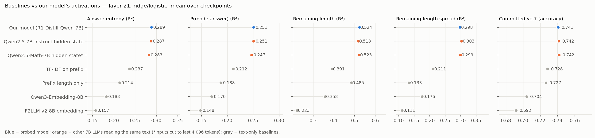
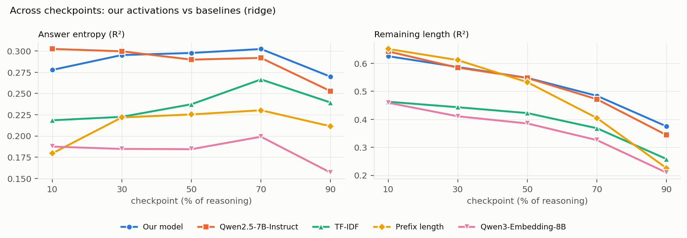
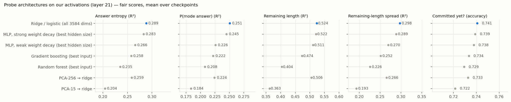
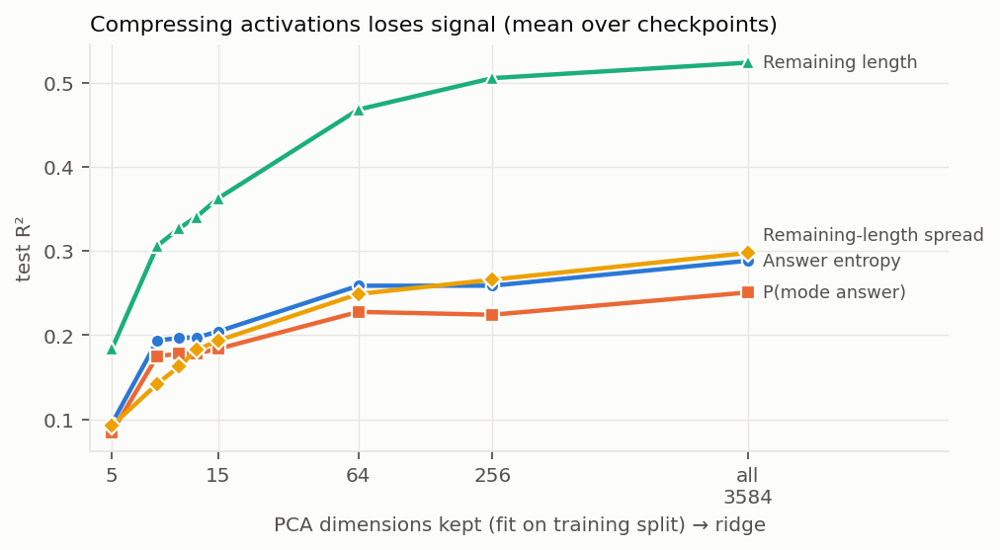
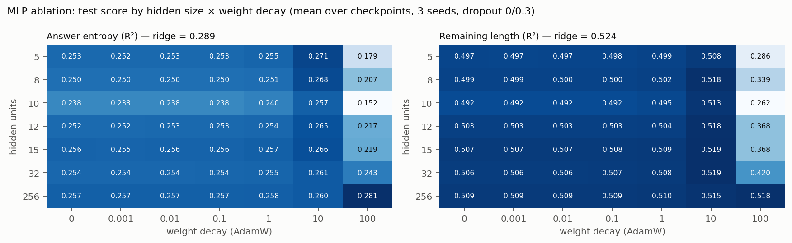

# Probing update — 2026-10-05

**Question:** do the model's activations at a reasoning prefix predict where the reasoning is going (answer uncertainty, remaining length, commitment) better than the prefix text does?

## Headline findings
- **Best probe: plain ridge (logistic for the yes/no target) on all 3,584 dims of layer-21 activations.** No other architecture beat it on any target.
- **Activations beat every text-only baseline** (TF-IDF, prefix length, sentence embeddings). Example — entropy R²: 0.289 vs 0.237 (TF-IDF); remaining length: 0.524 vs 0.485 (prefix length).
- **But other 7B LLMs reading the same text match our model's activations.** "Our model" = DeepSeek-R1-Distill-Qwen-7B, the reasoning model that wrote the chains. A plain chat model (Qwen2.5-7B-Instruct) and our model's pre-reasoning base (Qwen2.5-Math-7B), given the same text, score the same (entropy 0.287 / 0.283 vs 0.289; remaining length 0.518 / 0.523 vs 0.524). The edge looks like "a 7B LM reading the text", not private knowledge of the reasoning model. Caveat: all three share Qwen2.5 pretraining.
- **The signal looks linear.** Small MLPs reach ridge only with strong weight decay; random forests and gradient boosting fall short; compressing to 5–15 dims (PCA) loses about a third of it.
- **Sentence embedders are weak baselines here** — below TF-IDF and below prefix length on most targets.
- **Prefix length alone** still beats activations for remaining length early on (10%: 0.652 vs 0.626; 30%: 0.612 vs 0.587).
- No significance tests yet (bootstrap CIs pending); differences under ~0.01 should be read as ties.

## 1. Setup

**Models — what "our model" and the "other-LLM controls" are**
- **Our model = DeepSeek-R1-Distill-Qwen-7B**, the reasoning model being studied. It wrote every reasoning chain, and its own continuations from each prefix define the targets. "Our model's activations" = its layer-21 hidden state (3,584 numbers) at the last token of the prefix, while reading its own reasoning.
- **Other-LLM controls = different 7B models reading the same text.** We feed them the question + choices + our model's prefix, take their layer-21 hidden state at the last token (same layer and position as ours), and train the same probes.
  - *Qwen2.5-7B-Instruct*: an ordinary (non-reasoning) chat model, same size and architecture (28 layers, 3,584-dim). Never saw these chains.
  - *Qwen2.5-Math-7B*: our model's own base, i.e. our model before its reasoning fine-tuning. Only reads 4,096 tokens, so longer inputs keep their last 4,096 (cuts 26/44/55% of inputs at 50/70/90%).
- **Why the controls matter:** if our model's activations beat text baselines, is that (a) private knowledge about its own future reasoning, or (b) what any capable LLM extracts from the text? Matching scores from the controls point to (b).
- **Caveat:** all three share Qwen2.5 pretraining, so they may read text alike. An unrelated model (e.g. Llama-3.1-8B) would be a cleaner control — not run yet.

**Common to all experiments**
- Data: GPQA-Diamond, 198 questions × 25 reasoning chains written by our model. Checkpoints at 10/30/50/70/90% of each chain (24,575 prefixes).
- Targets (from 25 sampled continuations per prefix): answer entropy (Miller-Madow), P(mode answer), mean remaining length, spread of remaining length (regression, R²); "committed yet?" (binary, accuracy).
- Features: layer-21 hidden state at the last prefix token (3,584 dims), unless stated.
- Evaluation: one model per checkpoint; 5 folds **fixed per question** (a question is in the same fold at every checkpoint; no question in both train and test); hyperparameters chosen by inner 3-fold grouped CV on training questions only ("fair score"). Numbers below are test scores averaged over the 5 checkpoints.
- Pipeline: `src/probing/sweep.py` + `configs/*.yaml`; reproduces the earlier results exactly (90/90 cells).

**Baselines**
- *Prefix length*: token count → ridge.
- *TF-IDF*: 1–2-grams, 20k features, on prefix text → ridge.
- *Sentence embeddings*: Qwen3-Embedding-8B and F2LLM-v2-8B (top open ~8B embedders, 32k context, no truncation); text = question + choices + prefix; last-token pooling, L2-normalised, fixed generic instruction → ridge/logistic.
- *Other-LLM controls*: Qwen2.5-7B-Instruct and Qwen2.5-Math-7B hidden states (see "Models" above) → ridge/logistic.

**Probe architectures (all on layer-21 activations)**
- *Ridge / logistic*: penalty from a 13-point (ridge) / 6–8-point (logistic) log grid.
- *PCA-k → ridge*: k ∈ {5, 8, 10, 12, 15, 64, 256}, PCA fit on each training split only.
- *MLP*: 3584 → h → ReLU → dropout → 1; h ∈ {5, 8, 10, 12, 15, 32, 256}; dropout {0, 0.1, 0.3, 0.5}; AdamW weight decay {0, 0.001, 0.01, 0.1} then rerun with {1, 10, 100}; lr 1e-4, ≤300 epochs, early stopping (patience 30) on 15% of training questions; 3 seeds. Settings came from a pilot (no early stopping → test R² 0.00).
- *Random forest*: 500 trees; inputs raw / PCA-16/64/256; max_depth {None, 8}, min_samples_leaf {1, 5, 20, 50}, max_features {sqrt, 0.1, 0.3} (0.3 skipped on raw for cost).
- *Gradient boosting* (sklearn HistGradientBoosting): same inputs; lr 0.05, ≤1000 rounds with early stopping on held-out questions; max_leaf_nodes {7, 15, 31} × min_samples_leaf {20, 100} × L2 {0, 1} × max_features {0.1, 0.3}.

## 2. Results

**Baselines vs activations** (Fig. 1, Fig. 2)

| features | entropy | P(mode) | rem. length | length spread | committed (acc) |
|---|---|---|---|---|---|
| **Our model, layer 21** | **0.289** | **0.251** | **0.524** | 0.298 | 0.741 |
| Qwen2.5-7B-Instruct, layer 21 | 0.287 | 0.251 | 0.518 | **0.303** | **0.742** |
| TF-IDF | 0.237 | 0.212 | 0.391 | 0.211 | 0.728 |
| Prefix length | 0.214 | 0.188 | 0.485 | 0.133 | 0.727 |
| Qwen3-Embedding-8B | 0.183 | 0.170 | 0.358 | 0.176 | 0.704 |
| F2LLM-v2-8B | 0.157 | 0.148 | 0.223 | 0.111 | 0.692 |

- Our model vs each other-LLM control: wins only 10–11 of 20 (checkpoint × target) cells, mean gap ≤ 0.002.
- Qwen2.5-Math drops at 90% (entropy 0.233 vs 0.270), where most inputs were cut.

**Probe architectures** (Fig. 3)

| probe (fair score) | entropy | P(mode) | rem. length | length spread | committed (acc) |
|---|---|---|---|---|---|
| **Ridge / logistic** | **0.289** | **0.251** | **0.524** | **0.298** | **0.741** |
| MLP, strong weight decay (best h) | 0.283 | 0.245 | 0.522 | 0.289 | 0.739 |
| MLP, weak weight decay (best h) | 0.266 | 0.226 | 0.511 | 0.270 | 0.738 |
| PCA-256 → ridge | 0.259 | 0.224 | 0.506 | 0.266 | 0.733 |
| Gradient boosting (raw input) | 0.258 | 0.222 | 0.474 | 0.252 | 0.734 |
| Random forest (best input) | 0.235 | 0.208 | 0.404 | 0.226 | 0.729 |
| PCA-15 → ridge | 0.204 | 0.184 | 0.363 | 0.193 | 0.722 |

- *MLP* (Fig. 5): hidden size barely matters (h=5 ≈ h=256). Dropout ±0.005. Weight decay ≤ 0.1 does nothing; 10 is best for small nets (+0.015); 100 is too strong for h ≤ 32 but best for h=256. Best MLP vs ridge per cell: mean −0.003, wins 9/25, max +0.004 — a tie at best. (Taking the best h is slightly optimistic for the MLP.)
- *PCA* (Fig. 4): 8–15 dims keep ~2/3 of entropy/P(mode) signal and ~65–70% for length; every k loses to all 3,584 dims. Train ≈ test at small k → capacity-limited, not overfitting. A supervised 5-unit MLP is far better than PCA-5 (entropy 0.27 vs 0.10).
- *Random forest*: max_features is the main knob (0.1 > sqrt on raw; 0.3 best on PCA-64/256); small leaves best; depth and seed barely matter (seed spread ≤ 0.003).
- *Gradient boosting*: best tree model (~89% of ridge on entropy) and insensitive to every hyperparameter (≤ 0.006); raw input beats all PCA inputs.

**Not done yet:** 0% checkpoint probes (data ready), other layers, bootstrap CIs, an unrelated-LLM control (e.g. Llama-3.1-8B), LLM-predicts-the-targets baselines.

## Figures
- Fig. 1 `figures/fig1_baselines.png` — all baselines vs our activations, per target
- Fig. 2 `figures/fig2_checkpoints.png` — entropy and remaining length across checkpoints
- Fig. 3 `figures/fig3_probes.png` — probe architectures (ridge vs MLP vs trees vs PCA)
- Fig. 4 `figures/fig4_pca.png` — R² vs PCA dimensions kept
- Fig. 5 `figures/fig5_mlp_ablation.png` — MLP hidden size × weight decay

_Regenerate figures: `source env.sh && $PY src/viz/update_figures.py`. All result paths: `CLAUDE.md` → Results index._
