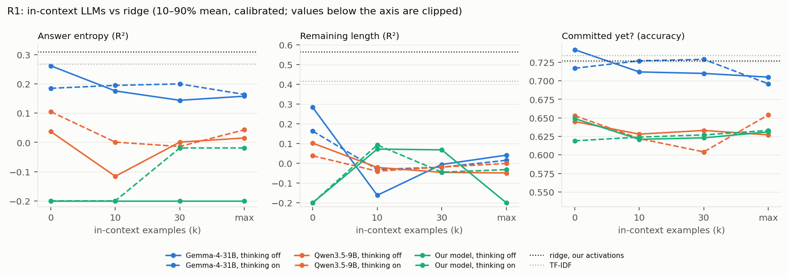
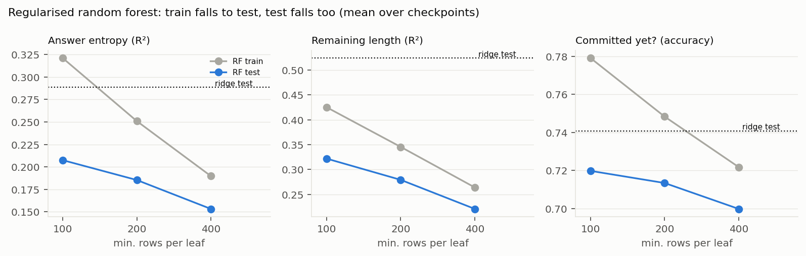
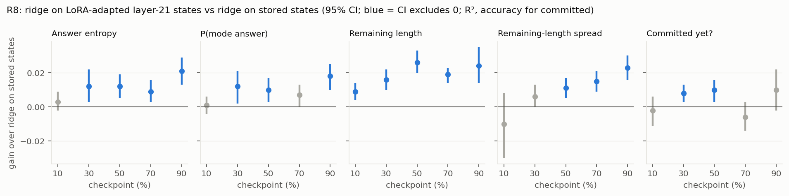
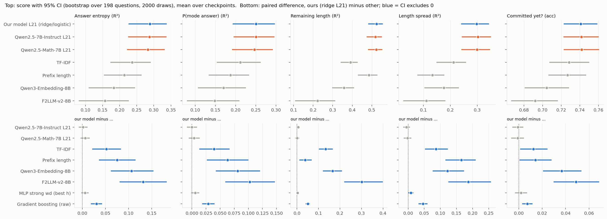
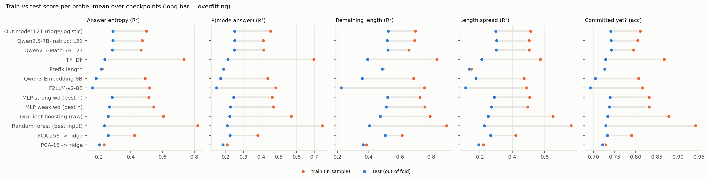
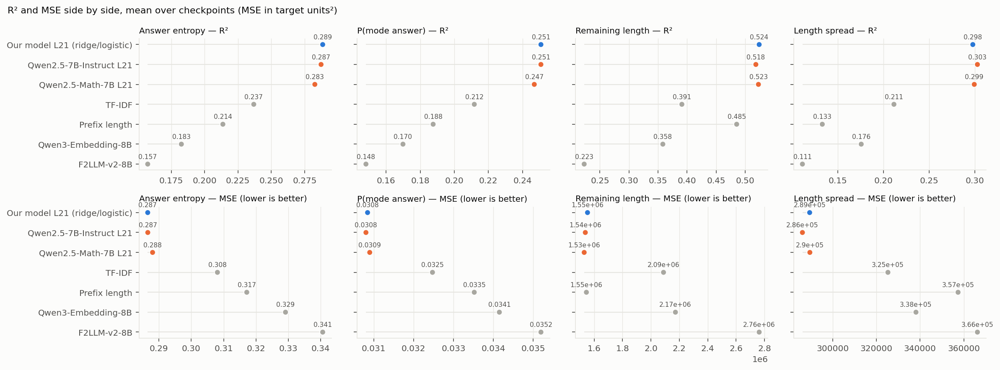
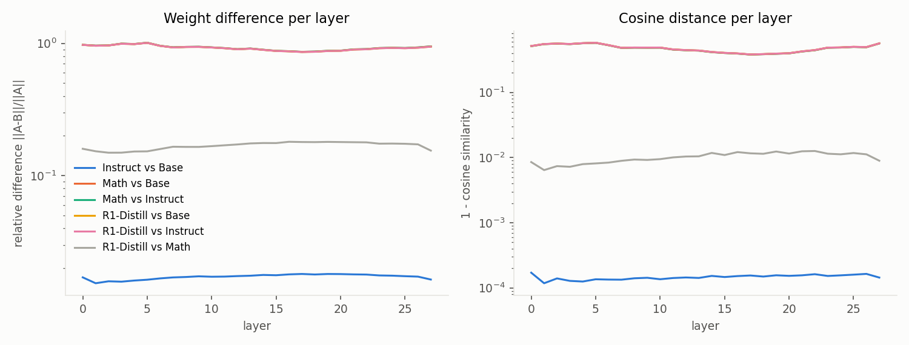
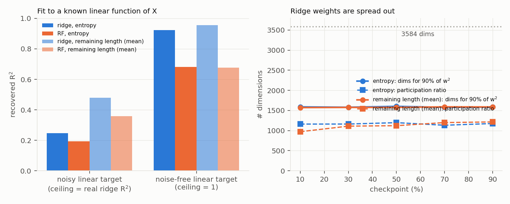

# Probing update — 2026-10-12 (round 2, since the 2026-10-05 update)

**Question (unchanged):** do the model's activations at a reasoning prefix predict where the reasoning is going (answer uncertainty, remaining length, commitment) better than the prefix text does?

**Round 2 = 8 items (R1–R8), set 2026-10-09:** in-context LLM baseline (R1), model bases (R2), why random forest < ridge (R3), embedder training length vs our inputs (R4), error bars (R5), train vs test / overfitting (R6), MSE next to R² (R7), LoRA + head probe (R8). Added along the way: a regularised random forest, LoRA controls, and ridge on LoRA-adapted activations.

## Headline findings
- **Ridge on layer-21 activations is still the probe to beat.** Nothing in round 2 beats it by much.
- **The Oct 5 ranking survives error bars (R5).** [*Find out how we got the error bars*] Our activations are significantly better than TF-IDF, prefix length and both sentence embedders on all 5 targets (entropy +0.05 / +0.07 / +0.11 / +0.13). They are **not** significantly different from the two other Qwen2.5-7B models reading the same text (gaps within ±0.006). One R² has a 95% CI of about ±0.05; paired comparisons are much tighter.
- **The controls share lineage, not weights (R2).** Our model is a fine-tune of Qwen2.5-Math-7B (14% relative weight difference). Qwen2.5-7B-Instruct is 79% away from ours, so "other 7B models match ours" is not explained by near-copied weights. All share architecture + tokenizer, so an unrelated family is still the clean test.
- **Random forests lose for a structural reason (R3).** The signal is a dense linear direction (~1,600 of 3,584 dims). Regularising the forest brings train down to test, but test falls too (entropy test 0.21 → 0.15 vs ridge 0.29).
- **An LLM reading the text in-context can tie ridge on uncertainty, not on length (R1).** Best: Gemma-4-31B, no examples, thinking off — entropy 0.262 vs ridge 0.309 (n.s.), committed 0.742 vs 0.727 (n.s.), remaining length 0.283 vs 0.563 (sig. worse). More examples and thinking both hurt. Qwen3.5-9B ≈ 0; our own model gives broken numbers.
- **LoRA gives a small real gain, but only read out with ridge (R8).** LoRA's own trained heads are always below ridge. Ridge fitted on the LoRA-adapted layer-21 activations beats ridge on the stored activations by +0.01 to +0.026 R², significant on most targets at 30–90%, nothing at 10%. One LoRA setting, one seed.
- **Embedders were not truncated (R4)**; inputs are often longer than F2LLM's training texts, but we see no sign this hurts.

## 1. Setup

**Common to all experiments (unchanged since Oct 5)**
- Data: GPQA-Diamond, 198 questions × 25 reasoning chains by our model (DeepSeek-R1-Distill-Qwen-7B); checkpoints at 10/30/50/70/90%.
- Targets: answer entropy (Miller-Madow), P(mode answer), mean remaining length, spread of remaining length (R²); committed yet? (accuracy).
- Reference probe: ridge / logistic on the layer-21 hidden state at the last prefix token (3,584 dims), penalty by inner 3-fold CV (`sweep/ref_fixed`).
- 5 folds fixed per question; every comparison below is on the same test rows.

**R5–R7 (error bars, overfitting, MSE)** — no refitting, from saved predictions/results
- R5: question bootstrap, 2,000 draws; differences are paired (same draws for both methods). `src/viz/round2_metrics.py`.
- R6: train vs test score from the existing `results.csv` files. R7: MSE from the existing `preds*.csv`.

**R2 (model bases)** — configs, tokenizers (token ids) and per-tensor relative weight difference of our model, Qwen2.5-Math-7B, Qwen2.5-7B-Instruct, plain Qwen2.5-7B (downloaded for this). `src/analysis/compare_model_weights.py`.

**R4 (embedder lengths)** — token counts of our inputs vs what each embedder was trained on (model cards, papers, training code).

**R3 + regularised RF**
- R3: ridge weight density; RF on a noise-free synthetic target that is exactly linear in our activations; leaf-size sweep; RF given ridge's prediction as one extra feature; RF on PLS-5. Entropy + remaining length, all checkpoints. `src/probing/r3_rf_diagnosis.py`.
- Regularised RF (asked for "good on both train and test"): raw layer-21 input, max_features 0.1, 300 trees, min_samples_leaf {100, 200, 400} × max_depth {None, 6, 3}; every setting scored, no selection. `configs/sweep_rf_reg.yaml`.

**R1 (in-context LLM baseline)**
- Models: our model (131k context), Qwen3.5-9B (native 262k, no YaRN), Gemma-4-31B-it (256k, 2 H100s). New env `envs/icl` (vLLM 0.31).
- Prompt: instructions (what the 5 numbers mean) → k labelled examples (full prefixes, never shortened; question + choices + prefix + checkpoint + true values as JSON) → query → instruction repeated. The model's name was removed from the prompt before the full runs ("A small reasoning model was given…").
- Examples come only from other folds, one CoT per question, checkpoints rotating 0–90%. Same example block for every row of a fold, so vLLM caches it.
- k ∈ {0, 10, 30, max}; max = 40 (ours), 92 (Qwen), 93 (Gemma) from exact token counts.
- Rows: 1 CoT per question × 6 checkpoints = 1,178 rows (vs ~75 GPU-h for all rows).
- Answer forced to a compact-JSON regex (vLLM structured outputs), greedy decoding.
- Thinking off: `enable_thinking=False` (Qwen, Gemma) or a prefilled end-of-thinking tag (ours). Thinking on: two passes — think until the model closes its thinking or hits 16k tokens, then the script appends the end tag and forces the JSON answer.
- Scoring: raw R² is < 0 for nearly every setup (wrong scale; the only exception is entropy for Gemma k=0: 0.139 thinking off, 0.010 on), so we report a **calibrated** score: a linear map from prediction to target fit on the other folds, per target and checkpoint.
- Getting there took 3 rounds of GPU smoke tests: (1) our model ignored the task and solved the GPQA question (0/40 usable) and Qwen thinking-on ran out of a 4k think budget → repeat the instruction after the query + force JSON; (2) Gemma's parser skipped thinking and long thinking hit the cap → two-pass thinking; (3) 100% of answers parse for all 3 models × off/on. `src/baselines/icl_predict.py`, `runs/gpqa25/11_icl.sh`.

**R8 (LoRA probe on our model)**
- Model: our model cut after layer 21 (layers 22–28 dropped, final norm removed), so its output *is* the layer-21 state the probes read. Check before training: cosine to the stored activations ≥ 0.9989 (mean 0.9996).
- LoRA on q, k, v, o, gate, up, down; alpha = 2 × rank. Head trained jointly from scratch: MLP 3584 → 256 → ReLU → dropout 0.3 → 5, or linear 3584 → 5 (`--hidden 0`). Loss: MSE on 4 standardised regression targets + BCE on committed.
- Recipe: lr 1e-4 (LoRA), 1e-3 (head), AdamW wd 0.01, 16 sequences per update, ≤3 epochs, early stopping on 15% of training questions (checked every 40 updates, patience 3).
- **One model per checkpoint per fold** (user decision: same data exposure as the probes; ~5× the cost of one pooled model).
- Variants (all at 10% first): all 21 layers rank 16 (30.3M trainable); layer 21 only (`--lora-layers 21`) at rank 4 / 16 / 64 (rank 4 = 0.4M); both heads each.
- Controls: same heads + same recipe on the stored activations, no LoRA (`--frozen`, CPU); then the step-4a head recipe (lr 1e-4, batch 256, wd 1 or 10, patience 30 epochs, ≤300 epochs).
- **Ridge on LoRA features:** layer-21 LoRA, rank 16, MLP head; after each fold, save the adapted layer-21 state of every row (`--save-states`), then fit the reference ridge/logistic (same grids, inner CV) on fold *i*'s states, from the LoRA trained on fold *i*'s training questions only. Check: the same pipeline on the stored states reproduces reference ridge exactly (difference 0.000 on all 5 targets). Run at all 5 checkpoints. `src/probing/lora_probe.py`, `lora_ridge.py`, `lora_compare.py`.
- Why single-layer LoRA still runs layers 1–20 on every token: the stored activations are only at the last token, but layer 21's attention at that token reads layer 20's output for *every* earlier token. Caching layer 20 for all tokens would be ~30 GB at 10%; not built.

## 2. Results

**R5 — error bars** (paired gap to ridge on our activations; fig `r5_ci_forest.png`)

| ridge on our activations vs | result |
|---|---|
| TF-IDF / prefix length / Qwen3-Embedding-8B / F2LLM-v2-8B | sig. better on all 5 targets (entropy +0.05 / +0.07 / +0.11 / +0.13) |
| gradient boosting | sig. better |
| MLP with strong weight decay | tie |
| Qwen2.5-7B-Instruct / Qwen2.5-Math-7B layer 21 | tie (within ±0.006) |

- Prefix length alone ties our activations on remaining length at 10–50%; activations win only at 70% and 90%.

**R6 / R7 — overfitting and MSE** (figs `r6_train_vs_test.png`, `r7_r2_vs_mse.png`)
- Random forest overfits most (entropy train 0.82 vs test 0.24), then TF-IDF. Ridge has a ~0.2 gap but the best test score.
- MSE ranks methods the same as R², except: averaged over checkpoints, prefix length has slightly lower MSE than activations on remaining length (early checkpoints have the largest errors and dominate the mean).

**R2 — model bases** (fig `r2_weight_similarity.png`)

| pair | relative weight difference |
|---|---|
| ours vs Qwen2.5-Math-7B | 0.14 (ours = fine-tune of Math) |
| Qwen2.5-7B-Instruct vs Qwen2.5-7B base | 0.013 |
| Qwen2.5-Math-7B vs Qwen2.5-7B base | 0.79 (heavy continued training; cause not verified) |
| ours vs Qwen2.5-7B-Instruct | 0.79 |

- Same architecture and tokenizer in all four. rope_theta 1e4 (ours, Math) vs 1e6 (Instruct, base).

**R4 — embedder lengths**
- No input > 32k tokens, so nothing was truncated.
- Inputs > 2,048 tokens: 39 / 60 / 69 / 75% at 30 / 50 / 70 / 90%. F2LLM's released training code uses 1–2k tokens; Qwen3-Embedding's training length is unpublished.
- No sign that length hurts: the embeddings' error relative to activations is U-shaped over length terciles (shortest inputs worst). Re-embedding F2LLM at 2,048 tokens (~45 GPU-min) was judged unnecessary.

**R3 + regularised RF** (figs `r3_fig*.png`, Fig. 7)
- Ridge weights are dense: ~1,600 of 3,584 dims hold 90% of the weight energy.
- On a noise-free synthetic linear target, RF reaches R² 0.68 vs ridge 0.92.
- Bigger leaves (1 → 20) cut RF train 0.90 → 0.58 with test flat: test is bias-limited, not variance-limited.
- RF + ridge's prediction as a feature closes ~50% (entropy) / ~90% (remaining length) of the gap, never beats ridge. RF on PLS-5 = linear PLS-5.

| regularised RF (no depth limit; mean over ckpts) | entropy train / test | rem. length train / test | committed train / test |
|---|---|---|---|
| default RF, leaf 5 (step 4c) | 0.83 / 0.24 | 0.86 / 0.39 | — |
| leaf 100 | 0.32 / 0.21 | 0.43 / 0.32 | 0.78 / 0.72 |
| leaf 200 | 0.25 / 0.19 | 0.35 / 0.28 | 0.75 / 0.71 |
| leaf 400 | 0.19 / 0.15 | 0.26 / 0.22 | 0.72 / 0.70 |
| **ridge / logistic** | **0.50 / 0.29** | **0.70 / 0.52** | **0.81 / 0.74** |

- max_depth 6 ≈ unlimited; depth 3 slightly lower. Stacking (ridge + RF on ridge's residuals) left for later.

**R1 — in-context LLMs** (Fig. 6; 10–90% mean, calibrated, same 1,178-row subset; gap to ridge with 95% CI)

| | entropy | P(mode) | rem. length | length spread | committed (acc) |
|---|---|---|---|---|---|
| **Ridge / logistic, our activations** | **0.309** | **0.261** | **0.563** | **0.328** | 0.727 |
| TF-IDF | 0.267 | 0.234 | 0.415 | 0.221 | 0.734 |
| Prefix length | 0.247 | 0.211 | 0.552 | 0.187 | 0.737 |
| Gemma, thinking off, k=0 | 0.262 (−0.05 [−0.13, 0.03]) | 0.237 (−0.02, n.s.) | 0.283 (−0.28*) | 0.069 (−0.26*) | **0.742** (+0.015 [−0.02, 0.05]) |
| Gemma, thinking off, k=93 | 0.158 (−0.15*) | 0.137 | 0.041 | −0.024 | 0.705 |
| Gemma, thinking on, k=0 | 0.185 (−0.12*) | 0.136 (−0.13*) | 0.163 (−0.40*) | 0.014 (−0.31*) | 0.717 |
| Gemma, thinking on, k=30 (best "on") | 0.200 (−0.11*) | 0.180 (−0.08*) | −0.020 (−0.58*) | −0.037 (−0.36*) | 0.729 |
| Qwen3.5-9B, best (thinking on, k=0) | 0.105 (−0.20*) | 0.069 | 0.038 | −0.001 | 0.653 (−0.07*) |
| Our model, thinking on, k=30/40 | ≈ 0 | ≈ 0 | ≈ 0 | ≈ 0 | 0.63 |

\* = 95% CI excludes 0. Always guessing the majority class gives 0.634 on committed.
- Gemma: more examples hurt at 10–90% (entropy 0.262 → 0.144–0.176) but help at 0% (0.065 → 0.187).
- Thinking: hurts Gemma at k=0; slightly helps it at k=10–30, still below thinking-off k=0. Median thinking / rows hitting the 16k cap — ours k=0 940 / 8%, k=40 81% capped; Qwen k=0 4.4k / 6%, k=92 84% capped; Gemma 1.3–1.6k / ≤4%.
- Our model with thinking off returns degenerate numbers (copies an example, or repeats one number in every field, e.g. entropy 420,230). With thinking on and 30+ examples the numbers are sane but worth R² ≈ 0.
- Parse failures: 0 (off), ≤1 per 1,178 rows (on).
- Caveat: only ~196 rows per checkpoint, so even TF-IDF vs ridge on entropy is n.s. here (it was significant in R5 with all rows).

**R8 — LoRA** (10% checkpoint, pooled test over 5 folds)

| run | entropy | P(mode) | rem. length | length spread | committed (acc) |
|---|---|---|---|---|---|
| **ridge / logistic, stored activations** | **0.278** | **0.251** | **0.626** | **0.304** | **0.767** |
| LoRA all 21 layers, MLP head | 0.189 | 0.151 | 0.591 | 0.286 | 0.755 |
| LoRA all 21 layers, linear head | 0.069 | 0.083 | 0.558 | 0.237 | 0.744 |
| LoRA layer 21, MLP head, rank 4 | 0.182 | 0.141 | 0.528 | 0.235 | 0.757 |
| LoRA layer 21, MLP head, rank 16 | 0.206 | 0.195 | 0.561 | 0.272 | 0.772 |
| LoRA layer 21, MLP head, rank 64 | 0.220 | 0.192 | 0.520 | 0.207 | 0.768 |
| LoRA layer 21, linear head, rank 4–64 | −0.11 to −0.13 | < 0 | 0.31–0.38 | < 0 | 0.74–0.75 |
| no LoRA, MLP head, same recipe | 0.123 | 0.069 | 0.534 | 0.212 | 0.750 |
| no LoRA, linear head, same recipe | −0.254 | −0.242 | 0.316 | −0.145 | 0.709 |
| no LoRA, MLP head, step-4a recipe (wd 10) | 0.220 | 0.191 | 0.602 | 0.289 | 0.763 |
| no LoRA, linear head, step-4a recipe (wd 10) | 0.154 | 0.125 | 0.584 | 0.221 | 0.740 |

- Every LoRA head is below ridge (MLP heads sig. worse on entropy, P(mode), remaining length; tie on committed). The all-layer linear head overfits (entropy train 0.64 vs test 0.07) and swings −0.09 to 0.25 across folds.
- The no-LoRA controls show the **head training recipe** is the bottleneck: the same heads on the stored activations score far below ridge. LoRA does improve on its own control (MLP entropy 0.12 → ~0.21). The step-4a recipe lifts the frozen MLP head to the level of the best LoRA run, still below ridge (entropy −0.058 sig.). Rank barely matters.
- A trained head is not ridge even when linear: ridge tunes a penalty per target by CV; the head shares one loss, one weight decay and one stopping point across 5 targets.

**R8 — ridge on LoRA-adapted activations, all checkpoints** (Fig. 8; gap to ridge on stored activations, 95% CI)

| checkpoint | entropy | P(mode) | rem. length | length spread | committed |
|---|---|---|---|---|---|
| 10% | +0.003 (n.s.) | +0.001 (n.s.) | +0.009 [0.004, 0.014] | −0.010 (n.s.) | −0.002 (n.s.) |
| 30% | +0.012 [0.003, 0.022] | +0.012 [0.002, 0.021] | +0.016 [0.010, 0.022] | +0.006 (n.s.) | +0.008 [0.003, 0.013] |
| 50% | +0.012 [0.005, 0.019] | +0.010 [0.003, 0.017] | +0.026 [0.020, 0.033] | +0.011 [0.005, 0.017] | +0.010 [0.003, 0.016] |
| 70% | +0.009 [0.003, 0.016] | +0.007 [0.000, 0.013] | +0.019 [0.014, 0.023] | +0.015 [0.009, 0.021] | −0.006 (n.s.) |
| 90% | +0.021 [0.013, 0.029] | +0.018 [0.010, 0.025] | +0.024 [0.014, 0.035] | +0.023 [0.016, 0.030] | +0.010 (n.s.) |

- E.g. 90%: ridge on LoRA activations 0.291 / 0.239 / 0.399 / 0.294 / 0.771 vs stored 0.270 / 0.222 / 0.375 / 0.271 / 0.761.
- LoRA's own MLP head is again well below ridge at every checkpoint (entropy 0.231 / 0.224 / 0.259 / 0.224 at 30 / 50 / 70 / 90%; sig. worse on 4–5 of 5 targets).
- Caveats: one LoRA setting (layer 21, rank 16, old head recipe), one seed. Gains are ~3–8% relative and much smaller than the feature-type differences in R5; they don't change the "our activations ≈ other Qwen2.5 controls" headline.

## 3. Compute notes

**Cluster usage** — all through `sbatch` on Sycamore, account `rc_ssriva_pi`
- GPU partition `h100_all`; CPU partition `small` (sweeps, bootstrap CIs, ridge on LoRA states).
- R1 jobs: `runs/gpqa25/11_icl.sh` (1 H100, 16 CPUs, 96 GB; Gemma: `--gres=gpu:h100:2 --mem=192G`), e.g.
  `ICL_MODEL=qwen35_9b ICL_KS="0 10 30 92" ICL_EXTRA="--thinking on --max-num-seqs 48" sbatch -t 48:00:00 runs/gpqa25/11_icl.sh`
- R8 jobs: `LORA_FRACTIONS="0.5" LORA_EXTRA="--lora-layers 21 --rank 16 --save-states --out-dir …" sbatch runs/gpqa25/12_lora.sh` (use `LORA_FRACTIONS`: `common.sh` overwrites `FRACTIONS`, which made the first "50%" LoRA test silently run 10%).
- CPU example: `sbatch -p small -c 2 --mem=16G -t 01:00:00 --wrap ". ./env.sh && \$PY src/baselines/icl_compare.py"`.

**vLLM settings for R1 (vs vLLM 0.31 defaults)**

| setting | ours | default (offline, H100) |
|---|---|---|
| `max_num_seqs` (completions in flight) | 16 (off); 32 ours / 48 Qwen / 16 Gemma (on) | 1,024 |
| `max_num_batched_tokens` | 16,384 | 16,384 |
| prefix caching | on | — |
| `max_model_len` | 131k / 262k (full context) | model's own |
| tensor parallel (Gemma) | 2 | 1 |
| `gpu_memory_utilization` | 0.92 | 0.92 |

- Concurrency = completions in flight, not parallel model copies: each step is **one** forward pass over a batch holding one new token per generating row plus chunks of prompts still being read (≤16,384 tokens per pass); a finished row is replaced by a waiting one. Each row keeps its own KV cache.
- KV-cache capacity: ours 1.05M tokens, Qwen 1.75M, Gemma 472k (Gemma thinking-on at 16 rows was near its limit).

**Measured throughput and utilisation**
- Thinking off (15-min snapshot, monitored every 30 s): startup 6–10 min (imports, ~70 s weight load, ~2 min engine setup). Input 200k–600k tokens/s reported (includes cached example tokens); output 120–490 tokens/s (answers are ~40 tokens). Rows/hour at max k: ~9,600 ours, ~8,000 Qwen. GPU 100% while generating, idle ~1 min between folds (prompt building on CPU) → busy ~60% after startup. GPU memory 77.7 / 80 GB (vLLM's up-front reservation). Host RAM peak 23 / 29 / 72 GB (ours / Qwen / Gemma). ~500 W per GPU busy, ~115 W idle. CPUs mostly idle.
- Thinking on: output ~620 tokens/s (ours, 32 in flight), ~760 (Qwen, 48), ~170 (Gemma, mostly prompt reading); Qwen at k=92 dropped to ~320 tokens/s (~250k-token prompts + up to 16k thinking).
- A labmate's 1.5k tokens/s at 64 concurrent requests on a 27B model is plausible but not comparable: our rows run at 100k+ context and thinking-off is almost all prompt reading.

**Wall time**

| run | time |
|---|---|
| R1 thinking off | ours 31 min, Qwen 36 min (1 GPU), Gemma 79 min (2 GPUs) |
| R1 thinking on | ours 13.0 h, Qwen 18.1 h (1 GPU), Gemma 15.2 h (2 GPUs) |
| R8 check / pilot | 6 min / 37 min (50%, 1 fold, 1 epoch, 16 GB) |
| R8 LoRA at 10% | all-layer 13–30 min per fold-job; layer-21 ~25 min per 5 folds |
| R8 ridge on LoRA features | GPU 0.8 / 1.6 / 2.4 / 3.1 / 4.2 h at 10–90% (≈12 h), + ~10 min CPU each; peak 11.7 → 16.5 GB |
| Regularised RF | ~23 min per shard × 5 (`small`, 12 CPUs) |
| R3 | ~20 CPU-h |

**Not done yet:** unrelated-LLM control (e.g. Llama-3.1-8B); 0% checkpoint probes; other layers; stacking (ridge + RF on residuals); more LoRA seeds or a LoRA trained with a ridge-like loss; R1 on all rows; final write-up.

## Figures
- Fig. 6 `figures/round2/fig6_icl.png` — R1: in-context LLMs vs ridge and TF-IDF, by number of examples, thinking off/on
- Fig. 7 `figures/round2/fig7_rf_reg.png` — regularised random forest, train vs test by leaf size
- Fig. 8 `figures/round2/fig8_lora_ridge.png` — R8: gain from LoRA-adapted activations under ridge, per checkpoint
- Earlier round-2 figures: `r5_ci_forest.png` (error bars), `r6_train_vs_test.png`, `r7_r2_vs_mse.png`, `r2_weight_similarity.png`, `r3_fig1_variants.png`, `r3_fig2_linear_and_spread.png`, `r3_fig3_topk.png`

_Regenerate Figs. 6–8: `source env.sh && $PY src/viz/update_1012_figures.py`. All result paths: `CLAUDE.md` → Results index._
